<h3 align="center">I build apps from the screen to the server.</h3>

Full stack software engineer in Dublin. I make apps look good, run fast and stay up. 
<b>3+ years, including <a href="https://www.umer-karachiwala.com/experience">Apple</a>.</b> MSc Computing (DevOps), ATU, 2:1. 
Right to work in Ireland (Stamp 1G).

<b>🟢 Open to software engineer roles in Ireland: full stack, backend, cloud and platform.</b>

<a href="https://www.umer-karachiwala.com/work"><b>See my work →</b></a> &nbsp;·&nbsp;
<a href="https://www.umer-karachiwala.com/experience"><b>Experience →</b></a> &nbsp;·&nbsp;
<a href="mailto:karachiwalaumer2612@gmail.com"><b>Email me →</b></a>

---

## ⚡ Experience

### &nbsp; Software Engineer · Online Store, SEO Engineering
Mar 2026 – Sep 2026 · Cork, Ireland · Java · Spring Boot · OpenSearch · Kafka · Cassandra · Amazon EKS

> **I made the change history of 900,000+ Apple Store pages searchable.**

- Built **changeset history search on OpenSearch**. Editors find any change to any page from one search bar, without opening each record
- Tuned custom index mappings across **9 SEO metadata fields**: word searches go to analysed text, exact lookups go to keyword fields, backed by benchmarks
- Stopped cyclic data corruption with validation and API checks on changes **scheduled up to 3 months ahead**
- Shipped features across **4 Java and Spring Boot microservices** on multi-datacentre Amazon EKS, alongside Kafka, Cassandra, Solr and Splunk
- Cut non-production changeset processing from **minutes to seconds** with a cleanup script for stuck pending records across 3 test environments
- My **GenAI hackathon prototype** for regulatory documents won **executive sponsorship** to go to production

<table>
<tr>
<td width="50%" valign="top">

### &nbsp; WebOsmotic · Software Engineer
Oct 2023 – Jun 2025 · Surat, India · Node.js · C# · Python · AWS · Azure

> **I kept a live platform fast at 100+ sessions at once.**

- Scaled containerised services on **Amazon EKS and Azure AKS** for **100+ concurrent live sessions**
- Moved heavy jobs to **SQS and SNS** workers, so API response times held under load
- Delivered real-time **WebSocket** messages across Kubernetes pods with Redis and SQS adapters
- Kept each client's data separate with partitioned **S3**, **RBAC**, **Nginx TLS** and automated **Entra ID** onboarding
- Automated cloud setup in **Terraform**, and tuned MongoDB queries behind live dashboards

</td>
<td width="50%" valign="top">

### &nbsp; Logic Infotech · Software Engineer
Mar 2022 – Sep 2023 · Surat, India · React · Next.js · Node.js · MongoDB

> **I built online stores from the screen to the server.**

- Built the **React and Next.js** pages shoppers see
- Built **Node.js and MongoDB** APIs for catalogues, orders and checkout across several e-commerce platforms
- Added **Stripe and Razorpay** card payments to checkout

</td>
</tr>
</table>

---

## 🛰️ Featured projects

<table>
<tr>
<td width="50%" valign="top">

<h3 align="center"><a href="https://github.com/Umer-2612/mcp-eval-gate">mcp-eval-gate</a></h3>

<b>Tests the tools AI assistants rely on, and stops a release if they break.</b>

A CI regression gate for <b>MCP servers</b>. It records what a server's tools return and fails the build when the output gets worse, even when the schema does not change. It found a <b>real bug in the official MCP filesystem server</b>. <code>pip install mcp-eval-gate</code>

</td>
<td width="50%" valign="top">

<h3 align="center"><a href="https://github.com/Umer-2612/realtime-transcribe">realtime-transcribe</a></h3>

<b>Turns speech into text, and knows when you've stopped talking.</b>

Self-hosted <b>WebSocket speech-to-text</b>. It streams partial and final transcripts, and a <b>turn-detection model</b> decides when a speaker is done, so finished answers appear after 0.3 seconds of silence instead of waiting 1.5.

</td>
</tr>
</table>

<b>More projects</b>

 

| Project | What it is |
|---|---|
| [Interview Platform](https://github.com/Umer-2612/platform) | One-link hiring platform. A candidate gets a single **token-gated link and no account** for three rounds: timed DSA, an AI voice technical interview, and a VS Code bug-fix. In progress: 3 of 6 services built ([core-api](https://github.com/Umer-2612/core-api), [web-frontend](https://github.com/Umer-2612/web-frontend), [judge-service](https://github.com/Umer-2612/judge-service)) |
| [Realtime Meeting Intelligence](https://github.com/Umer-2612/realtime-meeting-intelligence) | Bots that join **Zoom and Microsoft Teams** calls, capture raw audio and video, and stream it to a Python server for **live transcription and analysis**. Windows and Linux workloads on **AWS EKS** |
| [Greening the Pipeline](https://github.com/Umer-2612/msc-devops-dissertation) | MSc DevOps research at ATU Donegal: measures the **carbon cost of CI/CD** across 5 open-source projects (HTTPie, got, Retrofit, resty, Gson) and compares which pipeline changes cut it most. Full replication package included |
| [memory-core](https://github.com/Umer-2612/memory-core) | **FastAPI** service for long-term AI memory: semantic search on **pgvector** with free local embeddings, optional Claude integration |
| [FedSC-Risk](https://github.com/Umer-2612/FedSC-Risk) | Federated learning with **differential privacy** (Flower, Opacus, PyTorch) for supply chain risk prediction |
| [Restaurant platform (Australia)](https://github.com/Umer-2612/Restaurant-Api) | Backend API with **Stripe** payments and admin controls for a client restaurant site, on AWS EC2 with health checks and auto-restart |
| [Vernacular Text Interpreter](https://github.com/Umer-2612/Cursor-Hackathon-Dublin) | Cursor Hackathon Dublin: turns Hinglish typed in English letters into Devanagari, meaning, intent and tone |
| [umer-claude-skills](https://github.com/Umer-2612/umer-claude-skills) | My Claude Code skills for code review, git workflow and writing tone |

---

## 🧰 Stack

<table align="center">
<tr>
<td align="center" width="50%"><b>Frontend</b>  </td>
<td align="center" width="50%"><b>Backend</b>  </td>
</tr>
<tr>
<td align="center"><b>Cloud &amp; DevOps</b>  </td>
<td align="center"><b>Data</b>  </td>
</tr>
<tr>
<td align="center" colspan="2"><b>AI</b>   
    </td>
</tr>
</table>

---

## 🏆 Recognition

- **Employee of the Month** ("The Challenge Seeker") at WebOsmotic, for backend work
- **FusionHack 2024 finalist**: Go API for event management with real-time scheduling
- **300+** problems solved on LeetCode · mentored **20+** students for coding interviews

---

## 🎓 Education

- **MSc Computing in DevOps**, Atlantic Technological University, Donegal, Ireland · Sep 2025 – Sep 2026 · **2:1**
- **B.Tech Computer Engineering**, Bhagwan Mahavir College of Engineering and Technology, Surat, India · 2021 – 2025 · CGPA 8.48/10

<b>Certifications</b>

 

- **AWS**: [Cloud Practitioner](https://www.credly.com/badges/606d2fd5-6070-472b-b85a-17a4cabab7c2/linked_in_profile) · [Generative AI Practitioner](https://www.credly.com/badges/019efbe7-c545-4de6-99cf-b45587f30951/linked_in_profile) · [ML and AI Fundamentals](https://drive.google.com/file/d/1h75fneLEfczamauyzlEg5lh1jv1Nqv_f/view?usp=sharing)
- **MongoDB**: [Cluster Reliability](https://www.credly.com/badges/ac181593-8bf6-442d-924f-da19f3afc932/public_url) · [Atlas Networking](https://www.credly.com/badges/77c8a856-1898-47b6-a280-e0570ec94227/public_url) · [Auth](https://www.credly.com/badges/fd19231d-fc72-4fa7-8e97-dcd92c3bd4b1/public_url) · [Search](https://www.credly.com/badges/66883cdd-e909-4a6d-9117-5d74919ee482/linked_in_profile) · [Vector Search](https://www.credly.com/badges/b5b6feb5-403a-4282-8cc4-4caa600fa5b7/linked_in_profile) · [AI Agents](https://www.credly.com/badges/9a5aae8d-b780-46be-9317-5498dfbabf79/public_url) · [RAG Apps](https://www.credly.com/badges/700f0cc9-2603-4b51-bd35-97e1aa1fa3b0/public_url) · [Memory for AI](https://www.credly.com/badges/ffcb954a-a89c-4af1-b36b-57eee47ccbcb/public_url)
- **Udemy**: [Web Development Bootcamp](https://www.udemy.com/certificate/UC-59573590-40a6-4c8e-be8f-bba6c4b28cfd/)

---

## 📊 GitHub stats

---

<b>Let's talk.</b> <a href="mailto:karachiwalaumer2612@gmail.com">karachiwalaumer2612@gmail.com</a> · <a href="https://www.umer-karachiwala.com/">umer-karachiwala.com</a>

